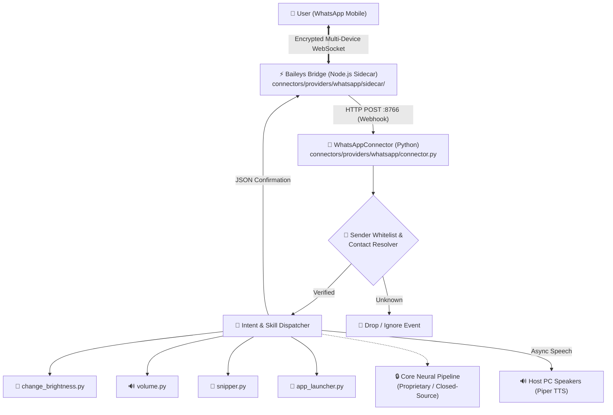

<div align="center">

# 🍼 B.A.B.Y
### Autonomous Desktop Voice Assistant & WhatsApp Remote Control Bridge

<br/>


<br/>

[](https://www.python.org/downloads/)
[](https://nodejs.org/)
[](LICENSE)
[](https://github.com/WhiskeySockets/Baileys)

<p align="center">
  <b>B.A.B.Y</b> is an intelligent, low-latency desktop companion and autonomous agent that bridges everyday desktop OS automation with remote mobile messaging. Control your entire PC environment on the fly directly through WhatsApp voice notes or text messages.
</p>

</div>

---

## ⚡ Highlighted Features (WhatsApp OS Remote Control)

* **Autonomous WhatsApp-to-OS Agent Interface**: Engineered a bi-directional bridge enabling full remote control of the host operating system, local browser automation, and AI workflows via WhatsApp voice notes and text messages with sub-second ingress latency.
* **Lightweight Multi-Device Baileys Sidecar**: Direct connection to WhatsApp Multi-Device WebSocket servers via `@whiskeysockets/baileys`. Runs in a tiny footprint (~35 MB RAM) without requiring heavy Chromium/Puppeteer instances or Meta API developer fees.
* **Strict Sender Security & Whitelisting**: Built-in phone number verification and alias mapping ensures system commands are strictly executed only when received from paired, authenticated owners.
* **Native Desktop OS Automation**: Execute system-level skills directly from WhatsApp commands:
  - 🔆 **Brightness Control**: Instant monitor display level adjustments (`skills/change_brightness.py`)
  - 🔊 **Master Volume Control**: Hardware audio mixer control, mute toggles, and volume scaling (`skills/volume.py`)
  - 📸 **Screen Snipper**: Desktop sub-region screen capture and automated WhatsApp image dispatch (`skills/snipper.py`)
  - 🚀 **App Launcher & Window Control**: Launch terminal, browser, and desktop applications remotely (`skills/app_launcher.py`)
* **Multimodal Audio Feedback**: Speaks execution status out loud through host PC speakers via high-speed neural TTS while simultaneously returning formatted text and media confirmations on WhatsApp.

---

## 🏗️ System Architecture



---

## 📂 Repository Structure

```text
BABY/
├── connectors/
│   ├── base.py                            # Base messaging connector interface
│   ├── manager.py                         # Connector registry & lifecycle manager
│   └── providers/
│       └── whatsapp/
│           ├── connector.py               # Bi-directional Python bridge & webhook listener
│           ├── contacts.py                # Security whitelist & alias manager
│           └── sidecar/
│               ├── bridge.js              # Baileys WebSocket multi-device engine
│               └── package.json           # Sidecar dependencies
├── skills/
│   ├── change_brightness.py               # Hardware monitor brightness controller
│   ├── volume.py                          # Master audio mixer controller
│   ├── snipper.py                         # Interactive screen region capture
│   └── app_launcher.py                    # Process spawner & desktop window switcher
├── img/
│   └── mascot/
│       ├── speaking.png                   # Original BABY chibi mascot (speaking)
│       ├── listening.png                  # Original BABY chibi mascot (listening)
│       └── sleeping.png                   # Original BABY chibi mascot (sleeping)
├── config.example.ini                     # Sanitized configuration template
└── README.md                              # Project documentation
```

---

## 🚀 Quickstart & Setup

### 1. Prerequisites
- Python 3.9+
- Node.js 18+
- Linux (X11 environment with `xdotool` and `amixer` recommended for OS automation)

### 2. Sidecar Installation
```bash
cd connectors/providers/whatsapp/sidecar
npm install
```

### 3. Configuration
Copy the template configuration file:
```bash
cp config.example.ini config.ini
```
Edit `config.ini` to specify your authorized WhatsApp phone number:
```ini
[connectors]
whatsapp_enabled = true
whatsapp_whitelist = 919876543210
```

### 4. Running the WhatsApp Bridge
Start the Node.js sidecar service:
```bash
node connectors/providers/whatsapp/sidecar/bridge.js
```
Scan the terminal QR code using WhatsApp on your phone (**Linked Devices** &rarr; **Link a Device**).

Once paired, your phone is instantly connected to execute desktop commands!

---

## 🔒 Security & License Notice
* **Local Authentication Only**: All WhatsApp session credentials and auth keys are encrypted and stored solely on the local machine (`credentials/whatsapp_session/`).
* **Zero Cloud Exposure**: Does not transmit private messages, audio clips, or personal data to third-party cloud servers.
* **Non-Commercial License**: This project is licensed under the **PolyForm Noncommercial License 1.0.0** - commercial use, redistribution for profit, or commercial hosting is strictly prohibited. See [LICENSE](LICENSE) for full legal terms.
* **Architecture Specification**: *Note: This repository contains the open modular interface and desktop connectors layer. Core proprietary neural voice models and backend weights are withheld.*
